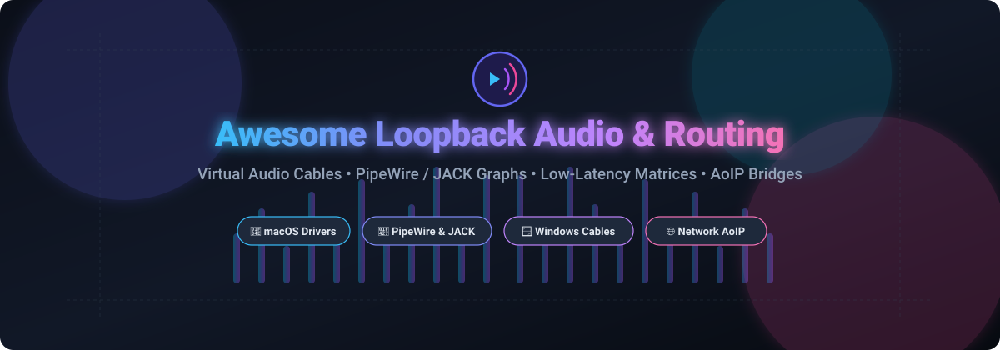

# 🎧 Awesome Loopback Audio & Audio Routing Utilities

**A curated, SEO-optimized directory of top loopback audio drivers, virtual audio cables, low-latency audio routing matrices, PipeWire/JACK graph patchbays, and network audio bridges (AoIP)—featuring commercial and proprietary platforms alongside their open-source equivalents.**

🌟 *Star if you like it!* 🌟

---

## 📑 Table of Contents

- [📊 Sector Overview & Market Dynamics](#-sector-overview--market-dynamics)
- [💼 SaaS & Commercial Hosted Platforms](#-saas--commercial-hosted-platforms)
- [🚀 Top Open-Source Equivalents & Tools (Sorted by Stars)](#-top-open-source-equivalents--tools-sorted-by-stars)
  - [🍎 macOS Virtual Audio Drivers & Loopback Routers](#-macos-virtual-audio-drivers--loopback-routers)
  - [🐧 Linux PipeWire, JACK & PulseAudio Graph Routers](#-linux-pipewire-jack--pulseaudio-graph-routers)
  - [🪟 Windows Virtual Audio Cables & Mixer Suites](#-windows-virtual-audio-cables--mixer-suites)
  - [🌐 Cross-Platform Network Audio & AoIP Routing](#-cross-platform-network-audio--aoip-routing)
  - [🎛️ Audio Effects, DSP Hosts & Per-App Volume Control](#️-audio-effects-dsp-hosts--per-app-volume-control)
- [📈 Star History](#-star-history)
- [🤝 Contributing](#-contributing)
- [💖 Support](#-support)

---

## 📊 Sector Overview & Market Dynamics

The global audio software and signal routing sector is estimated at approximately **$5.9B to $14.4B** (with the broader professional audio and audio processor ecosystem expanding past **$14B+ to $19B** by the 2030s). The market exhibits a **moderately fragmented, bifurcated structure**: while network-level Audio-over-IP (AoIP) protocol routing is concentrated around dominant standard-bearers like Audinate Dante, consumer, desktop, and studio virtual audio routing remains highly fragmented among boutique indie kernel/driver developers, freemium donationware utilities, and major gaming peripheral conglomerates using software suites to anchor hardware ecosystems.

---

## 💼 SaaS & Commercial Hosted Platforms

Commercial, proprietary, and subscription/license-based virtual audio routing suites, studio audio hijackers, and commercial AoIP virtual soundcards sorted by company size / valuation (descending).

| Platform / Product | Developer / Company | Company Size (Valuation / Revenue) | Starting Tier Pricing | Free Tier Limits / Free Trial | Description |
| :--- | :--- | :--- | :--- | :--- | :--- |
| **[Elgato Wave Link](https://elgato.com)** | Corsair Gaming / Elgato | ~$1.46B – $1.49B annual revenue (Corsair Gaming) | Free ($0) | Free forever plan with full access; no hardware lock required as of v3.0 | Proprietary digital audio mixing and sub-routing software for macOS and Windows tailored for creators and streamers. |
| **[Sonar (SteelSeries GG)](https://steelseries.com)** | GN Store Nord / SteelSeries | ~$1.2B valuation (GN Store Nord acquisition) / $500M+ revenue | Free ($0) | Free forever plan with full access; unconstrained hardware support across all brands on Windows | Commercial Windows virtual audio routing and parametric EQ suite splitting game, chat, media, and mic channels. |
| **[Dante Virtual Soundcard](https://audinate.com)** | Audinate (ASX: AD8) | ~$118M – $187M market cap / $46M annual revenue | $14.99 (30-day license) / $49.99 (perpetual single machine) | 30-day free trial; full feature parity with paid tier during the 30-day evaluation period | Commercial software turning a Mac or PC into a Dante-powered AoIP interface with up to 64x64 channels over standard Ethernet. |
| **[Loopback](https://rogueamoeba.com)** | Rogue Amoeba | ~$5M – $10M estimated revenue / ~10–40 employees | $99.00 (single-user perpetual license) | Free trial; full feature access but overlays audible noise degradation after 20 minutes of continuous audio passing (resets by toggling device) | Industry-standard proprietary macOS virtual audio routing studio for combining applications and physical hardware into virtual audio devices. |
| **[Audio Hijack](https://rogueamoeba.com)** | Rogue Amoeba | ~$5M – $10M estimated revenue / ~10–40 employees | $69.00 (single-user perpetual license) | Free trial; full feature access but overlays audible noise degradation after 10 minutes per capture session (resets by restarting app) | Commercial macOS audio recording and node-based routing tool for capturing, processing, and redirecting any application's audio. |
| **[VoiceMeeter (Banana & Potato)](https://vb-audio.com)** | VB-Audio Software | ~$1M – $5M estimated revenue / Boutique independent developer | $8.33 / €7.00 (Standard donationware tier) | Free forever plan for personal non-commercial use; non-blocking donation nag reminder displayed after 30 days of evaluation | Proprietary donationware virtual audio mixer and multi-channel router for Windows streaming, podcasting, and VoIP workflows. |
| **[VB-Cable](https://vb-audio.com)** | VB-Audio Software | ~$1M – $5M estimated revenue / Boutique independent developer | $15.00 (approx. for additional cables A+B / commercial license) | Free forever plan for standard single cable on personal/educational setups; commercial deployment requires volume license | Proprietary virtual audio device driver for Windows and macOS acting as a zero-latency audio cable between two applications. |
| **[Virtual Audio Cable (VAC)](https://muzychenko.net)** | Eugene Muzychenko | <$1M estimated revenue / Independent developer | $15.00 – $50.00 (Home to Business perpetual license) | Free Lite version limited to 1 virtual cable, max 48 kHz/16-bit/2-channels, home non-profit use only; full Trial version injects voice reminder after 30 minutes | Commercial Windows kernel-mode WDM/KS virtual audio driver creating multiple independent virtual playback and recording endpoints. |
| **[Sound Siphon](https://staticz.com)** | Static Z Software | <$1M estimated revenue / Micro-developer (single-person studio) | $49.00 (perpetual license for up to 2 Macs) | 14-day free trial; full unrestricted access to all features during the 14-day evaluation window | Proprietary macOS virtual audio capture and routing driver enabling per-app audio isolation and multi-device mixing. |

---

## 🚀 Top Open-Source Equivalents & Tools (Sorted by Stars)

Free and open-source software (FOSS) virtual loopback drivers, PipeWire/JACK patchbays, cross-platform audio routers, and low-latency DSP hosts. Repositories below are ordered by GitHub star counts in descending order, complete with direct links to each project's stargazers.

* **[OBS Studio](https://github.com/obsproject/obs-studio)**  - Open-source broadcasting and live recording suite with per-app audio capture and virtual audio monitoring.
* **[BlackHole](https://github.com/ExistentialAudio/BlackHole)**  - Modern zero-latency macOS virtual audio loopback driver supporting 2 to 256 channels across Apple Silicon and Intel.
* **[Background Music](https://github.com/kyleneideck/BackgroundMusic)**  - macOS audio utility providing per-application volume control, auto-pause, and virtual audio recording.
* **[EarTrumpet](https://github.com/File-New-Project/EarTrumpet)**  - Popular open-source Windows volume control and per-app audio routing utility replacing the default mixer.
* **[AudioKit](https://github.com/AudioKit/AudioKit)**  - Audio synthesis, processing, and loopback/recording library for iOS and macOS.
* **[EasyEffects](https://github.com/wwmm/easyeffects)**  - Comprehensive limiter, equalizer, and DSP audio effects suite built natively for PipeWire on Linux.
* **[JUCE](https://github.com/juce-framework/JUCE)**  - Open-source cross-platform C++ framework for audio applications, routing, and VST/AU plugins.
* **[Soundflower](https://github.com/mattingalls/Soundflower)**  - Classic open-source macOS audio kernel extension allowing inter-app virtual audio routing.
* **[Audio Router](https://github.com/audiorouterdev/audio-router)**  - Open-source Windows utility for routing audio of specific applications to different output devices.
* **[sndcpy](https://github.com/rom1v/sndcpy)**  - Android audio forwarding tool streaming device audio to desktop computers over USB/ADB without root.
* **[JACK2 (JACK Audio Connection Kit)](https://github.com/jackaudio/jack2)**  - Professional low-latency sound server daemon providing real-time sample-accurate audio routing.
* **[SonoBus](https://github.com/sonosaurus/sonobus)**  - High-quality, low-latency peer-to-peer network audio streaming and routing across desktop and mobile.
* **[Carla](https://github.com/falkTX/Carla)**  - Feature-rich modular audio plugin host and patchbay supporting JACK, PipeWire, LV2, VST2/3, and AU.
* **[PipeWire](https://github.com/PipeWire/pipewire)**  - Next-generation Linux multimedia graph server unifying JACK and PulseAudio with ultra-low latency.
* **[FlexASIO](https://github.com/dechamps/FlexASIO)**  - Flexible, universal open-source ASIO driver wrapper bridging WASAPI, WDM-KS, and DirectSound on Windows.
* **[Synthesis ToolKit (STK)](https://github.com/thestk/stk)**  - Open-source audio signal processing and algorithmic synthesis classes in C++.
* **[JackTrip](https://github.com/jacktrip/jacktrip)**  - High-fidelity multi-machine network audio routing system over local and wide area networks.
* **[qpwgraph](https://github.com/rncbc/qpwgraph)**  - Qt-based visual patchbay and graph manager for PipeWire with ALSA/JACK/MIDI routing.
* **[Virtual Audio Capture Grabber](https://github.com/rdp/virtual-audio-capture-grabber-device)**  - Open-source DirectShow virtual audio capture filter for Windows loopback recording.
* **[gavv Audio Snippets](https://github.com/gavv/snippets)**  - Collection of audio loopback, routing, and capture utilities for Linux PulseAudio and ALSA.

---

### 🍎 macOS Virtual Audio Drivers & Loopback Routers

* **[BlackHole (Existential Audio)](https://github.com/ExistentialAudio/BlackHole)**  - Modern, zero-latency open-source macOS virtual audio loopback driver supporting 2 to 256 channels across Intel and Apple Silicon.
* **[Background Music](https://github.com/kyleneideck/BackgroundMusic)**  - Open-source macOS audio utility providing per-application volume control, auto-pause, and system audio recording via a virtual driver.
* **[Soundflower (MATTINGALLS)](https://github.com/mattingalls/Soundflower)**  - Classic open-source macOS kernel extension allowing applications to pass audio seamlessly to other applications.
* **[AudioKit](https://github.com/AudioKit/AudioKit)**  - Audio synthesis, processing, and loopback/recording library for iOS and macOS.

---

### 🐧 Linux PipeWire, JACK & PulseAudio Graph Routers

* **[JACK2 (JACK Audio Connection Kit)](https://github.com/jackaudio/jack2)**  - Professional, low-latency open-source sound server daemon providing real-time sample-accurate audio and MIDI routing between applications.
* **[Carla](https://github.com/falkTX/Carla)**  - Fully featured open-source audio plugin host and modular patchbay supporting JACK, PipeWire, LV2, VST2/3, and AU routing.
* **[PipeWire](https://github.com/PipeWire/pipewire)**  - Next-generation open-source Linux multimedia server unifying JACK and PulseAudio with ultra-low-latency graph-based audio/video routing.
* **[qpwgraph](https://github.com/rncbc/qpwgraph)**  - Feature-rich Qt-based open-source graph manager for PipeWire enabling persistent patchbay presets and ALSA/JACK node routing.
* **[gavv Audio Snippets](https://github.com/gavv/snippets)**  - Collection of audio loopback, routing, and capture utilities for Linux PulseAudio and ALSA.

---

### 🪟 Windows Virtual Audio Cables & Mixer Suites

* **[EarTrumpet](https://github.com/File-New-Project/EarTrumpet)**  - Popular open-source Windows volume control and per-app audio device routing utility replacing the default system mixer.
* **[Audio Router](https://github.com/audiorouterdev/audio-router)**  - Open-source Windows utility for routing audio of specific applications to different output devices.
* **[FlexASIO](https://github.com/dechamps/FlexASIO)**  - Flexible, universal open-source ASIO driver wrapper bridging WASAPI, WDM-KS, and DirectSound for low-latency Windows audio routing.
* **[Virtual Audio Capture Grabber](https://github.com/rdp/virtual-audio-capture-grabber-device)**  - Open-source DirectShow virtual audio device for Windows enabling instant loopback capture of system playback audio.

---

### 🌐 Cross-Platform Network Audio & AoIP Routing

* **[sndcpy](https://github.com/rom1v/sndcpy)**  - Lightweight open-source tool forwarding Android device audio to desktop computers over USB/ADB without root.
* **[SonoBus](https://github.com/sonosaurus/sonobus)**  - High-quality, low-latency open-source peer-to-peer network audio streaming and routing application for macOS, Windows, Linux, and iOS.
* **[JackTrip](https://github.com/jacktrip/jacktrip)**  - Open-source multi-machine uncompressed audio system enabling ultra-low-latency bidirectional audio routing over local networks and the internet.

---

### 🎛️ Audio Effects, DSP Hosts & Per-App Volume Control

* **[OBS Studio (Application Audio Capture)](https://github.com/obsproject/obs-studio)**  - Open-source broadcasting studio featuring built-in per-application audio capture, virtual audio monitoring, and multi-track routing.
* **[EasyEffects (formerly PulseEffects)](https://github.com/wwmm/easyeffects)**  - Comprehensive open-source audio limiter, compressor, parametric equalizer, and noise-reduction suite built natively for PipeWire.
* **[JUCE](https://github.com/juce-framework/JUCE)**  - Open-source cross-platform C++ framework for audio applications, routing, and VST/AU plugins.
* **[Synthesis ToolKit (STK)](https://github.com/thestk/stk)**  - Open-source set of audio signal processing and algorithmic synthesis classes in C++.

---

## 📈 Star History

---

## 🤝 Contributing

Contributions are welcome! Feel free to open a Pull Request to add more open-source loopback audio drivers, PipeWire/JACK patchbays, virtual audio cables, or AoIP routing utilities.

1. 🍴 Fork the repository.
2. 🌿 Create your feature branch (`git checkout -b feature/cool-audio-tool`).
3. 📝 Add your project under the appropriate category with star badges and a concise description.
4. 🚀 Submit a Pull Request.

---

## 💖 Support

If you found this list helpful, please consider starring ⭐ this repository, sharing it with other audio engineers/streamers, or supporting future curation and open-source maintenance:

Thank you for your support! 🙌
